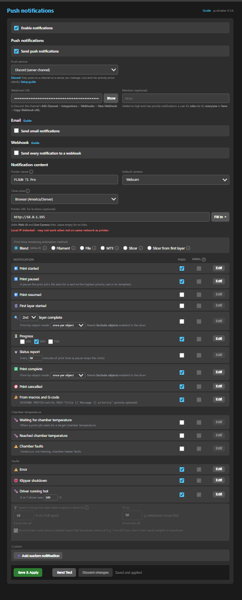
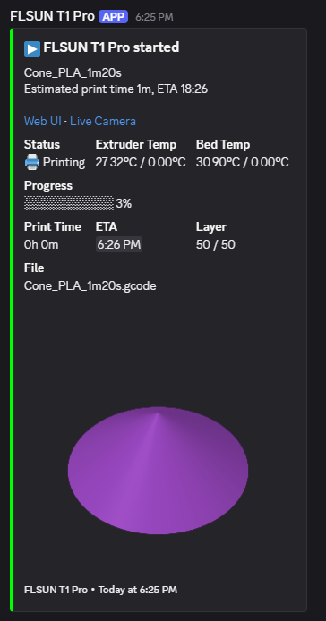
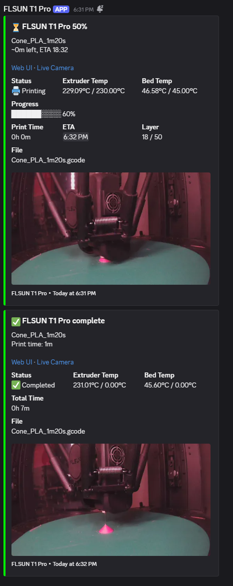

# FLSUN_pushraker

> **Archived 2026-11-18.** This plugin is now part of [diehard-pushraker](https://github.com/DIEHARDave/diehard-pushraker), one plugin for Kiln OS, Zmod and the FLSUN T1 (same features, plus the update notices). Your notification settings carry over: see its README, *Moving from the old plugins*.

> **Parts:** the printers, boards, readers and other gear that go with this project are listed at [projects.die-hard.net/gear](https://projects.die-hard.net/gear) (Amazon affiliate links).

Push notifications for the **FLSun T1 Pro**, from [pushraker](https://github.com/noon92/pushraker) by noon92. Get notified when a print starts, pauses, finishes or is cancelled, at progress marks, after the first layer, and on faults and shutdowns. Notifications come with a camera snapshot. They go out through [Apprise](https://github.com/caronc/apprise) to ntfy, Pushover, Gotify, Telegram, Discord, a webhook or email.

You set everything up on pushraker's own page at `http://<printer-ip>/notifications/`, and changes apply live, with no restart.

<p align="center"></p>

This repo is the installer and updater for the T1 Pro. pushraker itself comes from PyPI, at the version pinned in [`requirements.txt`](requirements.txt).

## What it does

- Installs pushraker into Moonraker's Python and runs pushraker's own installer. That installer adds:
  - the Moonraker component
  - `[pushraker]` in `moonraker.conf`
  - the Klipper macros in `pushraker.cfg`, included from `printer.cfg`
- Serves the settings page at `/notifications/` in Mainsail (port 80) and in Fluidd (port 81, if [FLSUN_Updater](https://github.com/DIEHARDave/FLSUN_Updater) installed it).
- Updates from Mainsail's and Fluidd's update manager. After an update, the `flsun_pushraker` service installs the pinned pushraker version. It restarts only what changed, and restarts Klipper only when no print is running.
- Checks itself at every boot, so a FLSun firmware update can't leave it half removed.
- Lays out Discord messages as [FLSUN_notify](https://github.com/DIEHARDave/FLSUN_notify)'s status cards (see [Discord cards](#discord-cards)).
- Fixes a bug in pushraker 0.3.6's settings page, where Save & Apply and Send Test fail with "Cannot read properties of null (reading 'checked')" on printers other than the Snapmaker U1. The fix has been sent upstream, and this step does nothing once a pushraker release includes it.

The print-complete and cancel snapshots are taken before the nozzle parks. `PRINT_END` in [FLSUN_Macros](https://github.com/DIEHARDave/FLSUN_Macros), and `END_PRINT` and `CANCEL_PRINT` in [FLSUN_klipper](https://github.com/DIEHARDave/FLSUN_klipper), call pushraker's hooks when it is installed. Update those two as well.

## Discord cards

A Discord message gets the same fields as FLSUN_notify's cards, under pushraker's title and text:

- Status, Extruder Temp and Bed Temp, side by side.
- During a print: a progress bar, then Print Time, ETA (shown in each reader's own time zone) and Layer, then File.
- When a print ends: ✅ Completed or 🚫 Cancelled, with Total Time and File.
- The printer's name and the time it was sent, in the footer.

<p align="center">
  
  
</p>

The color follows the printer: green while printing or complete, orange when paused, blue when ready. pushraker's error and failure notifications stay red. The camera snapshot stays inside the card, below the fields.

This is done by a small Moonraker component in this repo, `component/flsun_pushraker.py`, without changing pushraker's files. If a pushraker release changes what it hooks into, pushraker's plain Discord message goes out instead. To turn the cards off, set `discord_cards: False` under `[flsun_pushraker]` in `~/printer_data/config/flsun_pushraker.conf` and restart Moonraker.

## Requirements

- [FLSUN_moonraker](https://github.com/DIEHARDave/FLSUN_moonraker). pushraker needs Python 3.9 or newer, and FLSun's own Moonraker runs on Python 3.7. FLSUN_moonraker's Python already includes Apprise, Pillow and Jinja2, so nothing has to compile.
- Upstream Klipper ([FLSUN_klipper](https://github.com/DIEHARDave/FLSUN_klipper)) is recommended but not required.

## Install

The easy way is through [FLSUN_Updater](https://github.com/DIEHARDave/FLSUN_Updater): set `flsun_pushraker: yes` in `flsun_plugins.cfg`.

By hand, SSH into the printer as `pi` (the default password is `1`):

```sh
cd ~
git clone https://github.com/DIEHARDave/FLSUN_pushraker.git
~/FLSUN_pushraker/install.sh
```

Then open `http://<printer-ip>/notifications/`, choose where notifications go, pick the events you want, and turn it on. Send Test checks the setup.

The [Push Notifications guide](https://github.com/noon92/pushraker/blob/main/docs/guide.md) explains every setting.

## Where things live

- `~/printer_data/config/pushraker.conf`: your settings, which you can also edit by hand.
- `~/printer_data/pushraker.secrets`: your tokens and passwords, readable only by `pi`.
- `~/printer_data/logs/moonraker.log`: pushraker's log lines start with `[pushraker]`.
- `journalctl -u flsun_pushraker`: what the last sync did.

## Updating pushraker

This repo checks PyPI once a day for a new pushraker release. When there is one, it opens a pull request that bumps the version in `requirements.txt` and says whether the settings-page fix is still needed. The PR is tested on a T1 and then merged, and the update then shows in Mainsail's and Fluidd's update manager like any other.

To update by hand: `cd ~/FLSUN_pushraker && git pull && sudo ./sync.sh`.

## Uninstall

Turn it off in `flsun_plugins.cfg`, or run:

```sh
~/FLSUN_pushraker/uninstall.sh
rm -rf ~/FLSUN_pushraker
```

Your settings and secrets are kept, so a reinstall picks them up again.

## License

GPL-3.0. pushraker is GPL-3.0-or-later, by [noon92](https://github.com/noon92).
